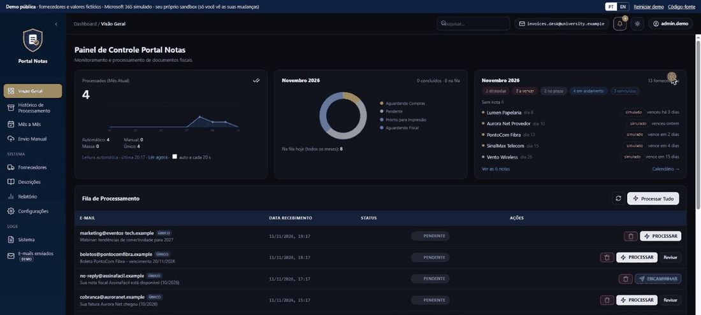
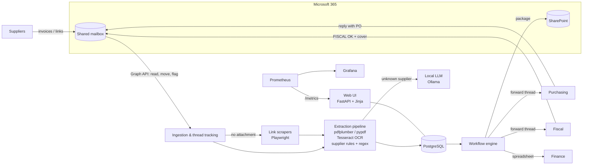
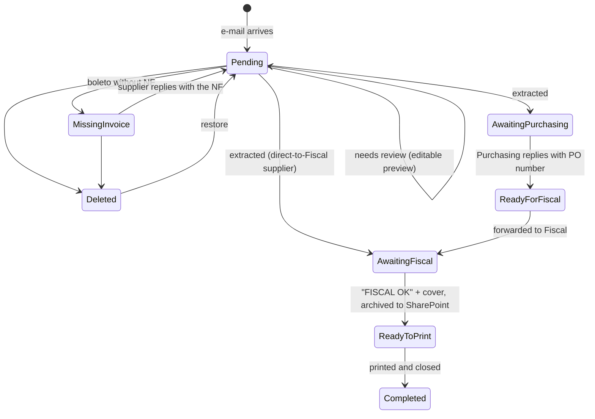

> 🇧🇷 [Versão em português](README.pt-BR.md)

# Portal Notas: supplier invoice automation (public demo)

Public, self-contained demo of a system I designed and built **solo**. The real one runs in **daily production** at a multi-campus private university in Brazil.

Every month, suppliers (ISPs, SaaS, hosting, domain registrars) e-mail their invoices to a shared mailbox. The system reads that mailbox, extracts the data from the PDFs (text layer or OCR), pairs each invoice (*nota fiscal*, NF) with its payment slip (*boleto*), sends the thread to Purchasing and Fiscal, archives the package to SharePoint and sends Finance a consolidated spreadsheet. Before it existed, a person did all of this by hand.



| Production numbers | |
|---|---|
| Invoices processed | **~50 per month** |
| Suppliers | **~30**, each with its own PDF layout |
| Manual work | **~85% less** (my estimate: time per invoice before vs. after) |
| Status | Daily production use; developed since March 2026 (~200 commits) |

> **Live demo: https://gualmeidap.github.io/portal-notas-demo/** (English and Portuguese, toggle at the top right)
>
> It runs **entirely in your browser**: the same Python code and tests in this repository are loaded into [Pyodide](https://pyodide.org) (CPython compiled to WebAssembly), so there is no server, no cold start and nothing you do leaves your machine. First load takes a few seconds.
>
> All data in this repository is **fictional**: supplier names, CNPJs, amounts and e-mail addresses (reserved `.example` domain). Microsoft 365, SharePoint, OCR, the LLM and supplier portals are replaced by in-memory mocks with the same contracts. No code, data or credentials from the production system are included.

---

## What you can try in the demo

| Feature | In the demo |
|---|---|
| Mailbox ingestion | "Check inbox" pulls new messages (mocked Microsoft Graph); the queue mirrors the mailbox folders (`Fila_Pendente`, `Fila_Excluidos`) and the read/unread flag |
| Extraction | **Real**: the engine reads actual PDF bytes (pypdf), classifies boleto / NF / combined, applies supplier rules and regex patterns, pairs NF and boleto by amount |
| OCR | Scanned samples have no text layer, so the engine takes the OCR branch. The transcription is pre-computed (no Tesseract in the demo). Reads below 80% confidence go to human review |
| Human review | Editable preview: missing or doubtful fields are highlighted and nothing moves on until someone confirms them |
| Unknown supplier | Flagged instead of guessed. Register it from the PDF with the **local LLM** (deterministic stand-in by default; set `OLLAMA_URL` to call a real Ollama model, as production does) |
| Suppliers that send links | The link scraper downloads the invoice from the (fictional) supplier portal |
| Missing invoice | A boleto without its NF waits; one click e-mails the supplier, and the reply re-enters the pipeline |
| Approval workflow | Purchasing replies with the purchase-order number, Fiscal replies "FISCAL OK" with a cover sheet. Both replies are **parsed from the thread** with the production rules |
| Archive & print | SharePoint archive (mocked URL) and a printable package: cover + NF + boleto merged into one PDF |
| Finance | Consolidated `.xlsx` spreadsheet (openpyxl), downloadable and "sent" to Finance |
| Overview | Month counters, per-day sparkline, status donut, supplier calendar widget, the processing queue and the extracted NF-e table (purchasing/fiscal dates, SharePoint link, PO number) |
| Month by month | Grid of tracked suppliers × months: arrived, overdue, due within 7 days, still on time, or marked *done outside*. Fed by the invoices as they arrive |
| Due dates | Expected due day per supplier, situation (overdue / due soon / received / on demand / outside the portal), paid or unpaid for the cycle, and a header bell that warns about what has not arrived |
| History + trash triage | Deleted e-mails grouped by category (scam, newsletter, other group's mailbox, payment reminder, handled, notice, account/system, other) with the suggested action; click a category to filter, restore from the table |
| Direct send | Per-supplier rules: *forward the e-mail as it is* (protected PDFs) or *read and send the table*; then close or *wait for the cover* (Awaiting Cover → Ready to print) |
| Routing settings | Purchasing/Fiscal addresses and recognized repliers, per-supplier Purchasing desk, senders/subjects removed on arrival (applied to the queue at once), daily Teams card preview, ticket-chasing terms with a preview |
| Reports | Deadlines by supplier (when the invoice/boleto usually arrives, this month and next), what each sender sends (NF, boleto, both, none) and e-mail types with the rule that decided |
| Descriptions | Default description per supplier key (with value-range rules), name normalization and the description template used for Purchasing |
| System logs | Level, area and user per entry, with period/area/text filters and a live mode |
| Restore | A deleted e-mail returns to the queue and to `Fila_Pendente` in the mailbox |
| Observability | `/metrics` in Prometheus format (production charts these in Grafana) |
| Bilingual | PT/EN toggle. In Portuguese, statuses show the production names (*Aguardando Compras*, *Pronto para Impressão*…); messages already on screen are translated too |

Each visitor gets an **isolated sandbox** seeded with two months of history: in the browser build it lives in the visitor's own tab; in server mode it is cookie-scoped and evicted after inactivity. Nobody sees anyone else's clicks and no database is needed.

## Architecture (production)



## Workflow



| Demo (English) | Production (Portuguese) |
|---|---|
| Pending | Pendente |
| Missing invoice | Sem Nota Fiscal |
| Awaiting Purchasing | Aguardando Compras |
| Ready for Fiscal | Aguardando Envio Fiscal |
| Awaiting Fiscal | Aguardando Fiscal / Direto Fiscal |
| Ready to print | Pronto para Impressão |
| Completed | Concluído |
| Deleted | Excluído |

Invalid transitions are refused with HTTP 409 (`app/workflow.py`).

## Technical decisions

1. **The mailbox stays organized as the database changes.** Every status change also moves the message in Microsoft 365 (`Fila_Pendente`, `Fila_Excluidos`) and sets its read flag. People who never open the web app still see an inbox that reflects the real state, and restoring a deleted e-mail undoes both sides.
2. **Rules first, LLM only where it pays off.** Extraction is deterministic: a supplier rules file plus regex patterns, so results are auditable, fast and free. The LLM is only used to *register* a new supplier from its first PDF. It runs **locally** (Ollama), so invoices never leave the network.
3. **Never guess.** A missing field, an unknown supplier or a low-confidence OCR read sends the e-mail to human review with an editable preview. A wrong amount sent to Finance costs more than a minute of review.
4. **NF-first pairing.** Suppliers send the invoice and the boleto as separate PDFs, as one combined PDF, or the boleto first and the invoice days later. Records are built around the invoice, and the boleto is matched by amount to supply the due date.
5. **Replies drive the workflow.** Nobody updates a status by hand. The system recognizes replies in the thread: a purchase-order number from Purchasing (several formats seen in practice), "FISCAL OK" from Fiscal, or a supplier reply with the missing invoice.
6. **Suppliers that don't attach PDFs** get a small scraper each. If no link is recognized, the e-mail stays in the queue: it is never silently marked as done.
7. **Observability from day one.** Prometheus metrics (app, PostgreSQL and Redis exporters) and a provisioned Grafana dashboard. When something breaks, the person who gets the ticket can see it.
8. **Demo-specific:** sample PDFs are generated at runtime from text fixtures (`app/samples.py`, `app/pdfgen.py`), so the repository contains no binary or real documents and every sample can be reviewed as plain text.
9. **Demo-specific: one route table, two runtimes.** `app/api.py` holds the HTTP routes. FastAPI serves them on a server (`app/main.py`); on GitHub Pages, `web/static/runtime.js` hands the page's API calls to the same table running under Pyodide (`app/browser.py`). The UI cannot tell the difference, and the tests cover both paths.
10. **Demo-specific: messages are data, not strings.** Every user-facing message is an `(en, pt)` pair (`app/i18n.py`) translated at the API boundary, so business code never formats text for one language.

## Production stack

Python · FastAPI · PostgreSQL (SQLAlchemy, Alembic) · Redis · Microsoft Graph API (mail, SharePoint, OAuth2) · pdfplumber / pypdf · Tesseract OCR (pdf2image, pytesseract) · Playwright · Ollama (local LLM) · openpyxl / pandas · ReportLab · JWT auth · Prometheus + Grafana · Docker Compose · GitHub Actions (tests, lint, Bandit security scan, Docker build).

The demo uses a subset: FastAPI (server mode), pypdf, openpyxl, Pyodide (browser mode) and vanilla JavaScript.

## Run locally

Server mode (FastAPI):

```bash
python -m venv .venv
# Windows: .venv\Scripts\activate    Linux/macOS: source .venv/bin/activate
pip install -r requirements-dev.txt
uvicorn app.main:app --reload
# open http://localhost:8000
pytest -q
```

Browser mode, exactly what GitHub Pages serves:

```bash
python tools/build_site.py
python -m http.server 8000 -d _site
# open http://localhost:8000
```

Optional, to register suppliers with a real local LLM (server mode):

```bash
OLLAMA_URL=http://localhost:11434/api/chat OLLAMA_MODEL=llama3.1:8b uvicorn app.main:app
```

## Project layout

```
app/
  api.py           route table shared by both runtimes (api_portal.py: overview, month by month, triage, reports, settings)
  main.py          server runtime (FastAPI): session cookie, one sandbox per visitor
  browser.py       browser runtime (Pyodide): called by web/static/runtime.js
  sandbox.py       business logic: ingestion, processing, review, workflow, finance
  portal.py        portal pages: expected-invoice calendar, month grid, trash triage, reports, settings
  extraction.py    PDF → text → classification → supplier → fields → NF/boleto records
  workflow.py      states, allowed transitions, mailbox folder mapping
  integrations.py  mocks: Graph mailbox, OCR, link scraper, local LLM, SharePoint, outbox
  i18n.py          (en, pt) message pairs, localized at the API boundary
  samples.py       fictional suppliers, documents and e-mails
  pdfgen.py        dependency-free PDF writer for the fixtures
config/vendor_rules.json   supplier rules (same shape as production, fictional content)
web/                       UI: index.html, static/ (app.js, pages.js, boot.js, i18n.js, runtime.js, app.css)
tools/build_site.py        static build for GitHub Pages (UI + Python package + pinned wheels)
tests/                     pytest
```

## Hosting

GitHub Pages, free and always on. `.github/workflows/pages.yml` runs the tests, builds the static site and publishes it on every push to `main`. The `Dockerfile` runs server mode on any container host if needed.

---

Built by [gualmeidap](https://github.com/gualmeidap)
