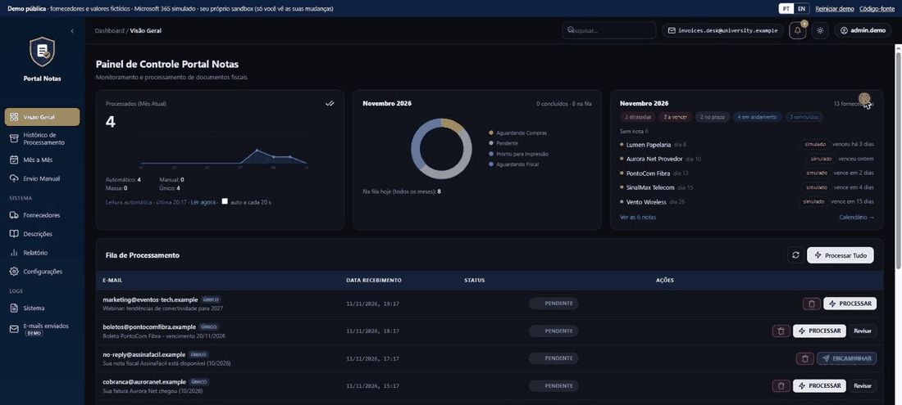
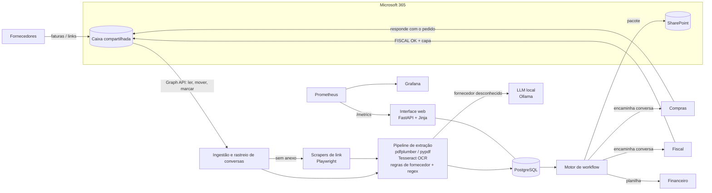
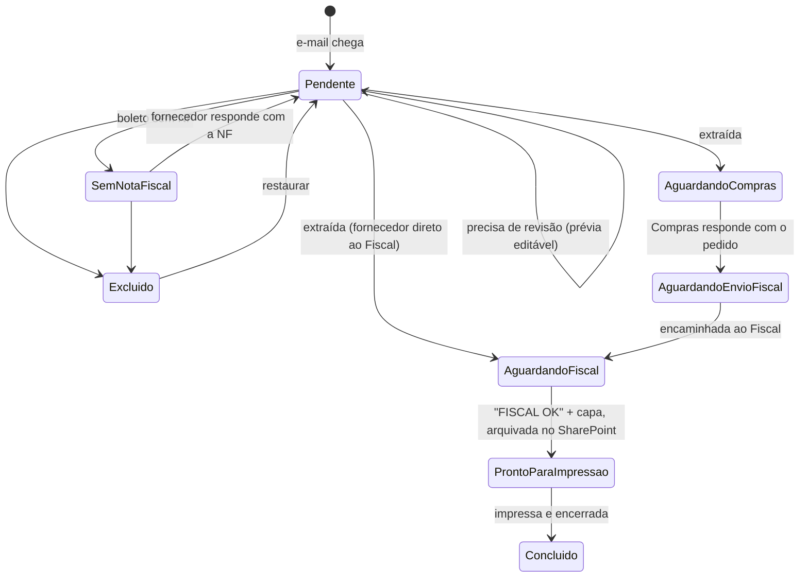

[](README.md) [](README.pt-BR.md)

> **Demo ao vivo:** https://gualmeidap.github.io/portal-notas-demo/ (roda inteira no seu navegador; PT/EN no canto superior direito)

# Portal Notas: automação de faturas de fornecedores (demo pública)

Demo pública e autocontida de um sistema que eu projetei e construí **sozinho**. O sistema real roda em **produção diária** em uma universidade privada multicampus no Brasil.

Todo mês, fornecedores (provedores de internet, SaaS, hospedagem, registradores de domínio) mandam as faturas por e-mail para uma caixa compartilhada. O sistema lê essa caixa, extrai os dados dos PDFs (camada de texto ou OCR), casa cada nota fiscal (NF) com o boleto correspondente, encaminha a conversa para Compras e Fiscal, arquiva o pacote no SharePoint e envia ao Financeiro uma planilha consolidada. Antes dele, uma pessoa fazia tudo isso à mão.



| Números de produção | |
|---|---|
| Notas processadas | **~50 por mês** |
| Fornecedores | **~30**, cada um com seu próprio layout de PDF |
| Trabalho manual | **~85% menos** (estimativa minha: tempo por nota antes vs. depois) |
| Situação | Uso diário em produção; desenvolvido desde março de 2026 (~200 commits) |

> **Demo ao vivo: https://gualmeidap.github.io/portal-notas-demo/** (inglês e português, alternância no canto superior direito)
>
> Ela roda **inteira no seu navegador**: o mesmo código Python e os mesmos testes deste repositório são carregados no [Pyodide](https://pyodide.org) (CPython compilado para WebAssembly). Não há servidor, não há partida a frio e nada do que você faz sai da sua máquina. O primeiro carregamento leva alguns segundos.
>
> Todos os dados deste repositório são **fictícios**: nomes de fornecedores, CNPJs, valores e endereços de e-mail (domínio reservado `.example`). Microsoft 365, SharePoint, OCR, o LLM e os portais dos fornecedores são substituídos por simulações em memória, com os mesmos contratos. Nenhum código, dado ou credencial do sistema de produção está incluído.

---

## O que você pode testar na demo

| Funcionalidade | Na demo |
|---|---|
| Leitura da caixa de e-mail | "Verificar caixa" busca mensagens novas (Microsoft Graph simulado); a fila espelha as pastas da caixa (`Fila_Pendente`, `Fila_Excluidos`) e o marcador de lido/não lido |
| Extração | **Real**: o motor lê os bytes reais do PDF (pypdf), classifica boleto / NF / documento combinado, aplica regras de fornecedor e padrões regex e casa NF e boleto pelo valor |
| OCR | Os exemplos digitalizados não têm camada de texto, então o motor segue o ramo de OCR. A transcrição é pré-calculada (a demo não tem Tesseract). Leituras abaixo de 80% de confiança vão para revisão humana |
| Revisão humana | Pré-visualização editável: campos ausentes ou duvidosos ficam destacados e nada avança até alguém confirmar |
| Fornecedor desconhecido | É sinalizado em vez de adivinhado. Cadastre-o a partir do PDF com o **LLM local** (substituto determinístico por padrão; defina `OLLAMA_URL` para chamar um modelo Ollama real, como na produção) |
| Fornecedores que mandam links | O scraper de links baixa a fatura do portal (fictício) do fornecedor |
| Nota ausente | Um boleto sem a NF fica esperando; com um clique o sistema cobra o fornecedor por e-mail, e a resposta volta para o fluxo |
| Fluxo de aprovação | Compras responde com o número do pedido de compra, o Fiscal responde "FISCAL OK" com folha de rosto. As duas respostas são **lidas da conversa** com as regras de produção |
| Arquivar e imprimir | Arquivo no SharePoint (URL simulada) e um pacote imprimível: capa + NF + boleto unidos em um único PDF |
| Financeiro | Planilha `.xlsx` consolidada (openpyxl), para baixar e "enviar" ao Financeiro |
| Visão geral | Contadores do mês, sparkline por dia, rosca de status, widget de calendário de fornecedores, a fila de processamento e a tabela de NF-e extraídas (datas de compras/fiscal, link do SharePoint, número do pedido) |
| Mês a mês | Grade de fornecedores acompanhados × meses: chegou, atrasada, vence em até 7 dias, ainda no prazo ou marcada como *concluída fora*. Alimentada pelas notas conforme chegam |
| Vencimentos | Dia de vencimento esperado por fornecedor, situação (atrasada / a vencer / recebida / sob demanda / fora do portal), pago ou não no ciclo e um sino no cabeçalho que avisa o que ainda não chegou |
| Histórico + triagem da lixeira | E-mails excluídos agrupados por categoria (golpe, newsletter, caixa de outro grupo, lembrete de pagamento, tratado, aviso, conta/sistema, outro) com a ação sugerida; clique em uma categoria para filtrar e restaure pela tabela |
| Envio direto | Regras por fornecedor: *encaminhar o e-mail como está* (PDFs protegidos) ou *ler e enviar a tabela*; depois encerrar ou *aguardar a capa* (Aguardando Capa → Pronto para Impressão) |
| Configurações de roteamento | Endereços de Compras/Fiscal e quem pode responder, mesa de Compras por fornecedor, remetentes/assuntos removidos na chegada (aplicado à fila na hora), prévia do cartão diário do Teams, termos de cobrança de chamados com prévia |
| Relatórios | Prazos por fornecedor (quando a nota/boleto costuma chegar, neste mês e no próximo), o que cada remetente envia (NF, boleto, ambos, nenhum) e os tipos de e-mail com a regra que decidiu |
| Descrições | Descrição padrão por chave de fornecedor (com regras por faixa de valor), normalização de nomes e o modelo de descrição usado para Compras |
| Logs do sistema | Nível, área e usuário por registro, com filtros de período/área/texto e modo ao vivo |
| Restaurar | Um e-mail excluído volta para a fila e para `Fila_Pendente` na caixa |
| Observabilidade | `/metrics` em formato Prometheus (na produção, esses gráficos ficam no Grafana) |
| Bilíngue | Alternância PT/EN. Em português, os status mostram os nomes de produção (*Aguardando Compras*, *Pronto para Impressão*…); mensagens que já estão na tela também são traduzidas |

Cada visitante recebe uma **caixa de areia isolada**, já com dois meses de histórico: na versão do navegador ela vive na própria aba do visitante; no modo servidor ela é presa a um cookie e descartada após inatividade. Ninguém vê os cliques dos outros e não é preciso banco de dados.

## Arquitetura (produção)



## Fluxo de trabalho



| Demo (inglês) | Produção (português) |
|---|---|
| Pending | Pendente |
| Missing invoice | Sem Nota Fiscal |
| Awaiting Purchasing | Aguardando Compras |
| Ready for Fiscal | Aguardando Envio Fiscal |
| Awaiting Fiscal | Aguardando Fiscal / Direto Fiscal |
| Ready to print | Pronto para Impressão |
| Completed | Concluído |
| Deleted | Excluído |

Transições inválidas são recusadas com HTTP 409 (`app/workflow.py`).

## Decisões técnicas

1. **A caixa de e-mail continua organizada conforme o banco muda.** Toda mudança de status também move a mensagem no Microsoft 365 (`Fila_Pendente`, `Fila_Excluidos`) e ajusta o marcador de leitura. Quem nunca abre o app web continua vendo uma caixa que reflete o estado real, e restaurar um e-mail excluído desfaz os dois lados.
2. **Regras primeiro, LLM só onde compensa.** A extração é determinística: um arquivo de regras por fornecedor mais padrões regex, então o resultado é auditável, rápido e gratuito. O LLM só é usado para *cadastrar* um fornecedor novo a partir do primeiro PDF. Ele roda **localmente** (Ollama), então as faturas nunca saem da rede.
3. **Nunca adivinhar.** Um campo ausente, um fornecedor desconhecido ou uma leitura de OCR com baixa confiança mandam o e-mail para revisão humana, com prévia editável. Um valor errado enviado ao Financeiro custa mais que um minuto de revisão.
4. **Casamento começando pela NF.** Fornecedores mandam a fatura e o boleto em PDFs separados, em um único PDF combinado, ou o boleto primeiro e a fatura dias depois. Os registros são montados em torno da fatura, e o boleto é casado pelo valor para fornecer o vencimento.
5. **As respostas conduzem o fluxo.** Ninguém atualiza status à mão. O sistema reconhece as respostas na conversa: o número do pedido de compra vindo de Compras (vários formatos vistos na prática), "FISCAL OK" vindo do Fiscal, ou a resposta do fornecedor com a nota que faltava.
6. **Fornecedores que não anexam PDF** ganham um scraper pequeno cada. Se nenhum link for reconhecido, o e-mail permanece na fila: nunca é marcado como concluído em silêncio.
7. **Observabilidade desde o primeiro dia.** Métricas do Prometheus (exporters da aplicação, do PostgreSQL e do Redis) e um dashboard do Grafana provisionado. Quando algo quebra, quem recebe o chamado consegue ver.
8. **Específico da demo:** os PDFs de exemplo são gerados em tempo de execução a partir de fixtures de texto (`app/samples.py`, `app/pdfgen.py`), então o repositório não contém binários nem documentos reais, e cada exemplo pode ser revisado como texto simples.
9. **Específico da demo: uma tabela de rotas, dois ambientes de execução.** `app/api.py` guarda as rotas HTTP. O FastAPI as serve em um servidor (`app/main.py`); no GitHub Pages, `web/static/runtime.js` entrega as chamadas de API da página à mesma tabela rodando sob o Pyodide (`app/browser.py`). A interface não percebe a diferença, e os testes cobrem os dois caminhos.
10. **Específico da demo: mensagens são dados, não strings.** Toda mensagem exibida ao usuário é um par `(en, pt)` (`app/i18n.py`) traduzido na fronteira da API, então o código de negócio nunca formata texto para um idioma específico.

## Stack de produção

Python · FastAPI · PostgreSQL (SQLAlchemy, Alembic) · Redis · Microsoft Graph API (e-mail, SharePoint, OAuth2) · pdfplumber / pypdf · Tesseract OCR (pdf2image, pytesseract) · Playwright · Ollama (LLM local) · openpyxl / pandas · ReportLab · autenticação JWT · Prometheus + Grafana · Docker Compose · GitHub Actions (testes, lint, varredura de segurança com Bandit, build do Docker).

A demo usa um subconjunto: FastAPI (modo servidor), pypdf, openpyxl, Pyodide (modo navegador) e JavaScript puro.

## Como rodar localmente

Modo servidor (FastAPI):

```bash
python -m venv .venv
# Windows: .venv\Scripts\activate    Linux/macOS: source .venv/bin/activate
pip install -r requirements-dev.txt
uvicorn app.main:app --reload
# abra http://localhost:8000
pytest -q
```

Modo navegador, exatamente o que o GitHub Pages serve:

```bash
python tools/build_site.py
python -m http.server 8000 -d _site
# abra http://localhost:8000
```

Opcional, para cadastrar fornecedores com um LLM local de verdade (modo servidor):

```bash
OLLAMA_URL=http://localhost:11434/api/chat OLLAMA_MODEL=llama3.1:8b uvicorn app.main:app
```

## Estrutura do projeto

```
app/
  api.py           tabela de rotas compartilhada pelos dois ambientes (api_portal.py: visão geral, mês a mês, triagem, relatórios, configurações)
  main.py          ambiente servidor (FastAPI): cookie de sessão, uma caixa de areia por visitante
  browser.py       ambiente navegador (Pyodide): chamado por web/static/runtime.js
  sandbox.py       lógica de negócio: ingestão, processamento, revisão, workflow, financeiro
  portal.py        páginas do portal: calendário de notas esperadas, grade mensal, triagem da lixeira, relatórios, configurações
  extraction.py    PDF → texto → classificação → fornecedor → campos → registros de NF/boleto
  workflow.py      estados, transições permitidas, mapeamento das pastas da caixa
  integrations.py  simulações: caixa Graph, OCR, scraper de links, LLM local, SharePoint, caixa de saída
  i18n.py          pares de mensagem (en, pt), localizados na fronteira da API
  samples.py       fornecedores, documentos e e-mails fictícios
  pdfgen.py        gerador de PDF sem dependências para as fixtures
config/vendor_rules.json   regras de fornecedor (mesmo formato da produção, conteúdo fictício)
web/                       interface: index.html, static/ (app.js, pages.js, boot.js, i18n.js, runtime.js, app.css)
tools/build_site.py        build estático para o GitHub Pages (interface + pacote Python + wheels fixadas)
tests/                     pytest
```

## Hospedagem

GitHub Pages, gratuito e sempre no ar. O `.github/workflows/pages.yml` roda os testes, monta o site estático e publica a cada push na `main`. O `Dockerfile` roda o modo servidor em qualquer host de contêiner, se necessário.

---

Feito por [gualmeidap](https://github.com/gualmeidap)
